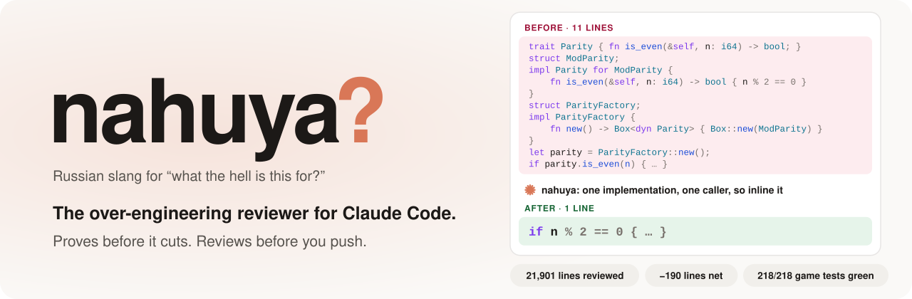
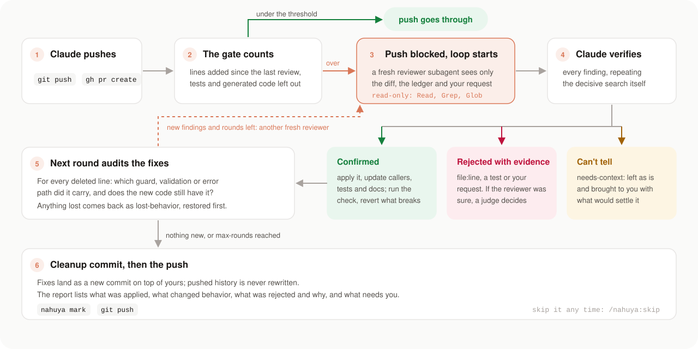

<p align="center">
  <picture>
    <source media="(prefers-color-scheme: dark)" srcset="assets/banner-dark.svg">
    
  </picture>
</p>

<p align="center">
  <b>English</b> · <a href="README.ru.md">Русский</a>
</p>

<p align="center">
  <a href="https://github.com/salatmaster/nahuya/actions/workflows/test.yml"></a>
  <a href="https://github.com/salatmaster/nahuya/releases"></a>
  <a href="LICENSE"></a>
  
  
</p>

<p align="center">
  <a href="#install">Install</a> ·
  <a href="#see-it-work">See it work</a> ·
  <a href="#how-the-pre-push-review-works">How it works</a> ·
  <a href="#a-yagni-code-reviewer-that-proves-before-it-cuts">The reviewer</a> ·
  <a href="#commands">Commands</a> ·
  <a href="#configuration">Configuration</a> ·
  <a href="#faq">FAQ</a>
</p>

**nahuya** is a [Claude Code](https://code.claude.com) plugin that stops AI over-engineering. Turn on its push gate, and when Claude is about to push a large change (500+ new lines by default), nahuya runs an AI code review first. The review removes abstractions, layers, options and dependencies that nothing needs, and it proves code is unused before cutting it. nahuya adds no rules that limit how the model thinks or writes.

<p align="center">
  
</p>
<p align="center"><sub>A real session with Claude Opus 5.5, replayed from a terminal recording with the waits shortened. The threshold was lowered to 80 lines for the demo; the default is 500. More sessions <a href="#see-it-work">below</a>.</sub></p>

<table>
<tr>
<td width="33%" valign="top">

**A reviewer that checks before it cuts**

It never calls code "unused" without a repo-wide search, and it looks where frameworks hide callers: decorators, DI, routes, reflection, serialization and public API.

</td>
<td width="33%" valign="top">

**A review-and-fix loop before big pushes**

Once you turn on the push gate, it starts on its own, with no CLAUDE.md edits. Claude re-checks every finding and backs each rejection with evidence. A judge settles disputes.

</td>
<td width="33%" valign="top">

**A one-paragraph disclosure layer**

No rules about thinking, no forced terseness, no reminder on every prompt. Claude lists what it added beyond the task, and you decide what stays.

</td>
</tr>
</table>

<p align="center"><sub><i>на*уя?</i> is Russian slang for "what the hell is this for?" · about 250 tokens of standing context per session</sub></p>

## Install

In Claude Code:

```
/plugin marketplace add salatmaster/nahuya
/plugin install nahuya@nahuya
```

Review and cleanup commands work right away. The push gate is off until you turn it on: open `/plugin configure nahuya@nahuya` and switch on **Block big unreviewed pushes**, or put `gate: on` in a project's [`.nahuya.md`](#project-notes-nahuyamd) to turn it on for everyone working on it. nahuya is plain POSIX `sh`, `awk` and `git`, with no Node, Python or jq. It is tested on Linux, macOS and Windows (Git Bash).

## See it work

Every animation here is a real session with Claude Opus 5.5, recorded in a terminal and replayed frame by frame with the waits shortened. What you see is what Claude Code drew.

**Push gate** (top of the page). Asked to add discount codes and push, Claude writes the feature and runs `git commit … && git push`. The gate blocks 113 unreviewed lines, Claude runs `/nahuya:polish`, a fresh reviewer finds nothing worth cutting, and the push goes through unchanged. Claude also lists what it added beyond the task (`added: …`).

**Whole-repo cleanup.** `/nahuya:polish all` on a 40k-line Minecraft mod. Claude plans 12 components, asks about tests and the reviewer budget, and cleans up the 7 most suspicious in 13 commits: 21,901 lines reviewed, net −190 lines, all 218 game tests green. This run has no terminal recording, so the scene is rebuilt from its session transcript.

<p align="center">
  
</p>

**Test cleanup.** Claude without nahuya was asked for a thorough suite for a small billing module and wrote 98 tests. `/nahuya:polish tests all --prune-tests` keeps 75 of them: −113 lines, checks green, no production code touched.

<p align="center">
  
</p>

**Report-only review.** `/nahuya:review` on a commit with a one-implementation notifier hierarchy, a retry wrapper and an options-laden formatter: 3 findings, about −40 lines, each with its searches. Nothing is changed until you say which to apply.

<p align="center">
  
</p>

## How the pre-push review works

<p align="center">
  <picture>
    <source media="(prefers-color-scheme: dark)" srcset="assets/flow-dark.svg">
    
  </picture>
</p>

**1. The gate.** It is off until you turn it on (see [Install](#install)). A hook watches the shell commands Claude runs. It blocks a push when the code added since the last review crosses the threshold. The count runs across any number of pushes, so splitting a feature into small pushes doesn't get around it.

<details>
<summary>What the gate recognizes and counts</summary>

<br>

- **Recognized as a push:** `git push` and `gh pr create`. This includes pushes inside chains (`commit && push`), subshells and `bash -c`, behind `git -C` or `cd`, and through git aliases.
- **Ignored:** dry runs, deletions and tag-only pushes.
- **Counted:** added lines of your own code since the last completed review. When the same command commits first (`git commit … && git push`), the work it is about to commit counts too (new files only if it runs `git add`). Deletions don't count, a moved file counts only its edits, and whitespace-only changes such as reindenting or running a formatter count nothing.
- **Excluded:** tests (including Rust modules declared under `#[cfg(test)]`), docs and data (Markdown, text, JSON, YAML, TOML, XML, configs, HTML/CSS, SVG), non-production folders such as `research/`, `examples/`, `benchmarks/` and `fixtures/` (the same ones whole-repo runs skip), lockfiles, `vendor/`, `node_modules/`, `dist/`, `build/`, `third-party/`, `Pods/`, Yarn's `.yarn/` and `.pnp.cjs`, `db/schema.rb`, minified and protobuf output, notebooks and translation files (`.ipynb`, `.po`, `.xliff`, `.strings`), Xcode and Visual Studio project files, files whose first lines say they are generated (`Code generated … DO NOT EDIT`, `@generated`, `# Generated by Django`), files marked `linguist-generated` or `linguist-vendored`, your `exclude:` globs, reverts, and code that isn't new work of this branch: commits any other remote branch already has (main, a fork's `upstream/main`, `develop`, the branch a stacked one was cut from), what you merged in or rebased onto, and on main itself, pulled commits that someone else wrote or committed, including your own PRs merged on GitHub. Commits already reviewed stay reviewed after a rebase; an amended or squashed commit counts again.

</details>

**2. The loop (`/nahuya:polish`).** Each round, a **fresh** reviewer subagent gets only the diff, the decision ledger and your own words for what you asked for. It never sees Claude's opinion of its own code.

- **Verification.** Claude re-checks every finding. Applying one needs Claude's own confirming search. Rejecting one needs evidence: a `file:line` that uses the code, a test, or your request. When the reviewer was confident and Claude still disagrees, a separate judge decides.
- **Checks.** Your test or build command runs after each round, and any fix that breaks it is reverted.
- **Lost behavior.** Later rounds audit the fixes themselves. For every line a fix deleted, the reviewer names the guard, validation or error path it carried and checks that the new code still has it. Anything lost is restored first.
- **Stopping.** Later rounds look only at what earlier fixes orphaned or lost. The loop stops after `max-rounds`, or earlier when a round applies nothing.
- **Passes.** To clean deeper, give it more passes: `/nahuya:polish all --passes 3`, or the `passes` setting. Each pass has fresh reviewers read the whole cleaned-up result again, with its own rounds and the same decision ledger, so nothing already settled is argued again. Every pass runs, and each one costs about as much as the first.

**3. The layer.** This one paragraph is added at session start, and again after `/clear` and compaction:

> If your change adds something the task could ship without — an abstraction or layer, a dependency, a config option, public API, a fallback or retry path, or generality for cases that don't exist yet — keep it if you judge it worth it and end your final message with one line each: `added: <what> — <why>`. Nothing to list, no line. Tests, validation at trust boundaries, handling of errors that can occur, resource cleanup, concurrency and transaction safety, and migrations are not extras.

That is the whole layer. It sets no limits and bans nothing; it makes the extras visible so you can veto them.

## A YAGNI code reviewer that proves before it cuts

Most YAGNI reviewers fail the same way: they call code dead because they didn't look where the framework calls it. Before nahuya's reviewer claims that anything is unused, has one implementation, or never varies, it searches the whole repo. It looks for the name, its string forms and its module path, and it checks these hidden callers:

| Hidden callers | Examples |
|---|---|
| Decorators and annotations | `@route`, `@app.get`, `@Component`, `@Bean`, `@pytest.fixture` |
| Registration and DI | containers, provider maps, plugin registries, entry points |
| Lookup by name | `getattr`, `Class.forName`, `send`, dynamic `import()` |
| Serialization | field names read by JSON, ORM or protobuf |
| Public API | published packages, documented exports |
| Operators | env vars and flags in deploy configs or docs |
| Everything else | templates, CLI definitions, IaC, migrations, tests |

Every search is reported with its match count. If the reviewer finds a concrete sign of a consumer outside the repo, it reports `needs-context` instead of guessing.

Besides over-engineering, the reviewer flags bloat:

- duplicated logic, including copies that drifted apart, where Claude points out the difference instead of silently picking one;
- boilerplate that a helper or generic would fold away;
- data reshaped back and forth for no reason (struct → DTO → map → struct);
- state that can be derived, or copies of state kept in sync by hand;
- wasted work: the same thing computed, parsed or fetched twice;
- special cases piled on a shared mechanism that one general rule would replace;
- code that does by hand what the platform already does, such as a DB constraint or a framework extractor;
- comments that restate the code;
- redundant tests.

Comments that explain *why* stay.

**Instructed never to flag:** validation at trust boundaries, security, data-loss error handling, resource cleanup, locks and transactions, migrations, API compatibility shims, observability, accessibility, and anything you asked for.

The reviewer has read-only tools (Read, Grep, Glob) and no shell. It treats text in your repo as evidence, not instructions, and Claude re-verifies every finding before applying it.

You can also run it by hand at any time, including on your whole codebase:

```
/nahuya:review                  # unreviewed commits + uncommitted changes
/nahuya:review main..HEAD       # a range
/nahuya:review all              # the whole codebase, report only
/nahuya:polish src/billing/     # review and fix existing code in a folder
/nahuya:polish tests all        # only the tests, across the whole repo
```

Put `tests` first to work on test code only. It combines with every target: `tests` alone covers the tests in your unpushed changes, and `tests all`, `tests src/` or `tests main..HEAD` work as usual. Test files are found by path and name. In Rust, modules declared under `#[cfg(test)]` count as test files, and in other sources only the lines inside `#[cfg(test)]` and `#[test]` items count as tests. Data such as JSON or YAML never counts as test code, even under `tests/` or `spec/`. Test helpers with ordinary names, like `testkit.rs`, are left to Claude: when it plans the run, it tags such components `[tests]`, and it can untag code that was taken for tests by mistake. A component that loses all its files to the test filter is reported, never dropped silently.

For the whole codebase or a folder, nahuya plans the run before spending anything:

- **Logical components, not line counts.** `nahuya inventory` builds a cheap map of directories, sizes, tests and build manifests. Claude groups the code by what it does: a feature, a service, a layer. Related code from different folders lands with the same reviewer, which is where duplicates show up. Each component is about 3000 lines (`shard-lines`) and gets its own fresh reviewer. Small targets skip planning. In short, the model plans and shell scripts do the counting.
- **Only code that ships.** Docs, generated and vendored files are skipped, and so are folders such as `research/`, `examples/`, `benchmarks/`, `fixtures/` and `playground/`. Claude tells you what it skipped, and `--with-nonprod` brings those folders back in.
- **Tests are your call.** Claude asks what to do with them:
  - leave them alone;
  - clean up duplicates and copy-pasted setup;
  - also remove tests that add nothing.

  A test adds nothing if it passes no matter how the code breaks, or if it only repeats a neighbor. The first kind has no real assertion, checks only what a mock returns, restates the type system, computes the expected value with the code under test, or has been disabled for good. The second kind exercises the same behavior on the same class of input as a test that stays. Each removal needs a mutation-style argument: either no plausible bug would make that test fail, or every bug that fails it also fails the test that stays. Regression tests stay, and so does the only test that catches a money, security or data bug, and the last test of any behavior. A test isn't protected just because it touches money.
- **A duplicates pass.** A cheap clone detector scans the whole target for near-identical code across files. One more reviewer then reads both sides of each pair. This catches what a per-shard review can't see, such as two modules built on the same skeleton.
- **A budget.** By default a run uses at most 10 reviewer subagents (`max-agents`). If it needs more, Claude asks first and shows the numbers for each option:
  - review the most suspicious components now and the rest as a later batch (`--skip N`);
  - use fewer, bigger components;
  - review everything, with a token estimate;
  - narrow to a folder.

Cleanup runs are `deep` by default. Small but real findings count, and behavior-preserving changes can span several files, for example extracting shared code or folding boilerplate. `/nahuya:polish all` commits after each shard and pushes only if you ask. The report says how many lines were reviewed, how many were cut, and what wasn't reviewed. When the run covered all of the code (the whole repo, no batch left for later, nothing skipped in the plan), it counts as the gate's review too, so your next push isn't blocked for the same lines.

## Why it won't make Claude worse

These are lessons from earlier anti-bloat plugins:

| nahuya does | because |
|---|---|
| Inject one short paragraph per session, never per prompt | An [independent benchmark](https://github.com/Deepusleepy/ponytail-benchmark) on Opus 4.8 found that an always-on ruleset roughly doubled input tokens and raised the cost per task, even as output shrank. One user [reported worse adherence to recent instructions](https://github.com/JayPokale/Chisle/issues/2) with per-prompt reminders. |
| Ask for disclosure, never "write less" | In the same benchmark, "write less" pressure dropped handling of edge cases the prompt didn't mention, and the strictest mode was the most fragile. |
| Keep the reviewer's context clean | Rules injected into reviewer subagents [made them report fewer findings](https://github.com/DietrichGebert/ponytail/issues/502). |
| Treat verification as the core | In a [study of 31,073 CodeRabbit comments](https://arxiv.org/abs/2607.03316), 56% were rejected. An unverified finding costs time; it doesn't help. |

nahuya also leaves thinking, prose style and file reading alone. Rules that ration reasoning or force terse output trade answer quality for a few tokens.

## Commands

| Command | What it does |
|---|---|
| `/nahuya:review [tests] [all\|folder\|base..tip]` | Report-only review. Changes nothing. With no argument it reviews your unpushed changes; `all` reviews the whole codebase. |
| `/nahuya:polish [tests] [all\|folder\|base..tip] [--passes N]` | Review-and-fix loop. With no argument it covers the commits waiting to be pushed (the gate sends Claude here). With `all` or a folder, it fixes existing code and commits, but never pushes. |
| `/nahuya:skip` | Skip review of everything up to the current commit. The gate counts only the commits after it, so the same lines don't block you again. Claude can't invoke this skill and is told not to bypass the gate. |
| `/nahuya:aliases [install\|remove]` | Add short commands `/nah-review`, `/nah-polish`, `/nah-skip` and `/nah-stats`. They go in `~/.claude/skills`, because plugin commands always carry the `nahuya:` prefix. `remove` deletes only these files. |
| `nahuya stats` | Applied and rejected findings by category and diff size, from your own history. Run it in a terminal from the plugin's `bin/`, or ask Claude to run it. |

## Configuration

| Setting | Default | Options |
|---|---|---|
| `gate` | `off` | `on` / `off` |
| `threshold` | `500` | unreviewed added lines that trigger the loop |
| `max-rounds` | `3` | review rounds per loop |
| `passes` | `1` | how many times a polish run reviews the whole result again from scratch; `--passes N` sets it for one run |
| `reviewer-model` | `inherit` | `inherit` / `opus` / `fable` / `sonnet` / `haiku`: the reviewer subagent's model |
| `fix-mode` | `commit` | `commit`: new commit · `amend`: only if HEAD isn't pushed · `uncommitted`: leave fixes for you |
| `layer` | `on` | `on` / `off` |
| `shard-lines` | `3000` | lines of code per reviewer in whole-repo and folder runs |
| `max-agents` | `10` | reviewer subagents per whole-repo or folder run before Claude asks you |
| `depth` | `auto` | `auto`: `deep` for whole-repo and folder cleanups, `normal` before pushes · `normal` · `deep` |

Change settings in `/plugin configure`. To override a setting for one repo, use git config in a terminal:

```
git config nahuya.threshold 1000                 # this repo
git config --global nahuya.reviewer-model fable  # every repo
git config --unset nahuya.threshold              # back to the plugin setting
```

To see every effective value and where it came from, ask Claude to run `nahuya config`.

nahuya reads each setting from these sources, in this order:
1. environment variables `NAHUYA_<SETTING>` (for example, `NAHUYA_GATE=0` in CI);
2. `git config nahuya.*` for the repo;
3. the front matter of `.nahuya.md`, which is committed and applies to everyone working on the project (see below);
4. the global git config;
5. the plugin's own settings (`/plugin configure`);
6. the defaults above.

### Project notes: `.nahuya.md`

This file is optional and goes at the repo root. Only nahuya's scripts and the reviewer read it, so it adds nothing to your sessions' context. Its front matter takes any setting from the table, for the whole project: `gate: on` to gate pushes for everyone on the project, say, or a higher `threshold`. When the gate blocks on code that doesn't ship, such as one-off scripts, Claude stops and suggests an `exclude:` line here instead of reviewing it. Claude doesn't edit this file itself.

```markdown
---
check: npm test            # runs after every round; fixes that break it are reverted
threshold: 1000            # any setting from the table, for everyone on this project
exclude:                   # left out of the line count and the review
  - src/generated/
  - "**/*.pb.ts"
---
We keep ports-and-adapters interfaces on purpose, even with one implementation.
Handlers in src/jobs/ are discovered by name at startup.
```

## FAQ

<details>
<summary><b>Why does Claude Code over-engineer, and how do I stop it?</b></summary>

<br>

Strong models fill gaps with generality: an interface "for later", a retry wrapper, an option nobody sets. Banning that tends to cost features and robustness. nahuya does two things instead. It makes every unrequested addition visible as an `added:` line. Then, before a big push, it reviews the change and removes the additions that turn out to be unneeded. You can also run `/nahuya:review` on any branch or folder.

</details>

<details>
<summary><b>How is this different from <code>/simplify</code> or <code>/code-review</code>?</b></summary>

<br>

Those run when you ask for them. nahuya differs in four ways:

- It runs on its own before a large push.
- It proves code is unused with repo-wide searches, including framework entry points, before cutting anything.
- Claude must back every rejected finding with evidence.
- It keeps a ledger, so later rounds don't re-argue findings that are already settled.

</details>

<details>
<summary><b>Does it remove dead code and unused abstractions?</b></summary>

<br>

Yes. Before a push, it removes them from the code being pushed, and on demand from any path. It targets:

- dead code;
- interfaces and factories with a single implementation;
- pass-through wrappers;
- options and config that nothing varies, and feature flags stuck on or off;
- dependencies declared in a manifest that no code imports;
- `try`/`catch` blocks that only rethrow;
- reimplementations of the standard library, of helpers you already have, or of what the platform does natively;
- dependencies added for a few lines;
- logic duplicated across files, and boilerplate that a helper would fold;
- comments that restate the code, and stale TODOs;
- redundant tests and copied test setup, and, if you ask, tests that can't fail or only repeat a neighbor;

To clean up existing code, run `/nahuya:polish all` or `/nahuya:polish src/`.

</details>

<details>
<summary><b>Can I run it on my whole codebase?</b></summary>

<br>

Yes. `/nahuya:review all` gives a report only, and `/nahuya:polish all` reviews and fixes. Pass a folder instead of `all` to narrow either one.

- **What gets reviewed.** Claude groups the code into logical components of about 3000 lines, and each one gets a fresh reviewer. A clone detector adds a pass for duplicates across files. Folders such as `research/` and `examples/` are skipped. Claude asks whether to include tests.
- **Budget.** Runs are capped at 10 reviewers by default. On a bigger codebase, Claude asks first:
  - review the most suspicious shards now and the rest in a later batch;
  - use fewer, bigger components;
  - review everything, with a token estimate;
  - narrow to a folder.

</details>

<details>
<summary><b>Will it make Claude dumber, lazier or terser?</b></summary>

<br>

No. nahuya has no rules about thinking, reply length, prose style or how files are read, and it never tells the model to write less. The layer only asks Claude to disclose what it added. The review runs in a separate subagent.

</details>

<details>
<summary><b>How many tokens does it cost?</b></summary>

<br>

About 250 tokens of standing context per session: the layer plus three short descriptions. The loop runs only when unreviewed code crosses the threshold. On a small demo repo, a 105-line change took two rounds on Opus 5.5 and cost about $0.52 at API prices, mostly in cached reads.

</details>

<details>
<summary><b>Does it gate pushes I make myself?</b></summary>

<br>

No. It gates only pushes that Claude makes. Your own `git push` is never touched, and nahuya installs no git hooks in your repos.

</details>

<details>
<summary><b>What about CI and headless <code>claude -p</code>?</b></summary>

<br>

The gate never prompts. It blocks the same commit at most three times, so a headless run can't loop forever; the push it then lets through counts as skipped, so the next commit doesn't start the cycle again. Set `NAHUYA_GATE=0` to turn it off in CI.

</details>

<details>
<summary><b>Does it work on Windows?</b></summary>

<br>

Yes, as long as Git for Windows is installed, because Claude Code uses its Git Bash to run hooks. Every commit is tested on Windows, macOS and Linux.

</details>

## Limitations

- Changes under the threshold (500 lines by default) are never reviewed automatically. Run `/nahuya:review` on those.
- A whole-repo run costs roughly one reviewer per 3000 lines, plus verification. The `max-agents` budget keeps that in check.
- It doesn't see pushes made outside Claude. It also doesn't see shell aliases such as `gp` that exist only in your interactive shell; git aliases do work.
- "Lines since the last review" is approximate: a rebase that changes a reviewed commit's patch, and every amend or squash, makes that commit count again.
- The reviewer can be wrong. That's why every finding is re-verified, rejections need evidence, and anything uncertain comes to you.

## Development

```
sh tests/run.sh                     # 202 tests; needs only sh, git and awk
claude --plugin-dir . -p "..."      # run Claude Code with this checkout loaded
claude plugin validate .
```

Issues and pull requests are welcome. Please keep the plugin dependency-free and keep the layer small. Add a line for any change users would notice under `[Unreleased]` in [CHANGELOG.md](CHANGELOG.md). Releases are cut from it by the Release workflow.

## License

[MIT](LICENSE)
