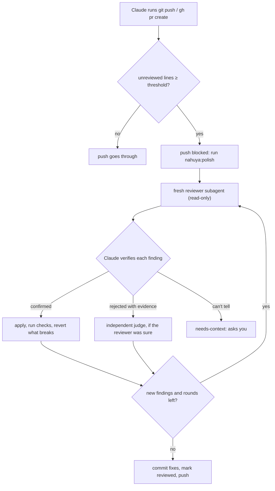

<p align="center">
  <picture>
    <source media="(prefers-color-scheme: dark)" srcset="assets/banner-dark.svg">
    
  </picture>
</p>

<p align="center">
  <b>English</b> · <a href="README.ru.md">Русский</a>
</p>

<p align="center">
  <a href="https://github.com/salatmaster/nahuya/actions/workflows/test.yml"></a>
  <a href="LICENSE"></a>
  <a href="#install"></a>
  
  
</p>

<p align="center">
  <a href="#install">Install</a> ·
  <a href="#see-it-work">See it work</a> ·
  <a href="#how-the-pre-push-review-works">How it works</a> ·
  <a href="#a-yagni-code-reviewer-that-proves-before-it-cuts">The reviewer</a> ·
  <a href="#commands">Commands</a> ·
  <a href="#configuration">Configuration</a> ·
  <a href="#faq">FAQ</a>
</p>

**nahuya** is a [Claude Code](https://code.claude.com) plugin that stops AI over-engineering. When Claude is about to push a large change (500+ new lines by default), nahuya runs an AI code review. The review removes abstractions, layers, options and dependencies that nothing needs, and it proves code is unused before cutting it. nahuya adds no rules that limit how the model thinks or writes.

<p align="center"><sub><i>на*уя?</i> is Russian slang for "what the hell is this for?"</sub></p>

The plugin has three parts:

- **A reviewer that checks before it cuts.** It never calls code "unused" without a repo-wide search. It also looks where frameworks hide callers: decorators, DI, routes, reflection, serialization and public API.
- **A review-and-fix loop before big pushes.** It starts on its own, with no CLAUDE.md edits. Claude re-checks every finding and must back each rejection with evidence. An independent judge settles disputes.
- **A one-paragraph disclosure layer.** It has no rules about thinking, no forced terseness and no reminder on every prompt. Claude lists what it added beyond the task, and you decide what stays.

The plugin costs about 250 tokens of standing context per session.

## Install

In Claude Code:

```
/plugin marketplace add salatmaster/nahuya
/plugin install nahuya@nahuya
```

It works right away. nahuya is plain POSIX `sh`, `awk` and `git`, with no Node, Python or jq. It is tested on Linux, macOS and Windows (Git Bash).

## See it work

<p align="center">
  
</p>

<p align="center"><sub>A replay of a real run with Claude Opus 5.5 on a small demo repo, condensed. The threshold was lowered to 50 lines for the demo; the default is 500.</sub></p>

<details>
<summary>Text version</summary>

```text
> I added a welcome email on signup. Push it to origin main.

● Bash(git push origin main)
  ⎿ nahuya: push blocked, nothing in this command ran. 105 unreviewed
    added lines of non-test code since bcdc6c6 (threshold 50).
    … then run the nahuya:polish skill with no arguments.

● Skill(nahuya:polish)
● nahuya:reviewer(Round 1 over-engineering review)
  ⎿ Done (8 tool uses · 16.8k tokens · 41.8s)
● Claude re-runs the decisive searches, applies 5 findings, checks pass
● nahuya:reviewer(Round 2 over-engineering review)
  ⎿ Done (6 tool uses · 12.4k tokens · 13.2s)
● Bash(git commit … ) ⎿ nahuya: f462c83 marked as reviewed
● Bash(git push origin main) ⎿ bcdc6c6..f462c83  main -> main

Applied: Notifier ABC + EmailNotifier (one implementation, no seam),
NotifierFactory (registry only ever holds "email"), send_with_retry
(send() can't fail), format_message options (never passed), plugin hook
(result discarded). Rejected: none. WELCOME_SENDER and /health untouched.
```

</details>

The demo repo also contained two traps: a `/health` handler that is reached only through a route table, and a setting that operators change in `deploy/app.env`. The reviewer left both alone. The fixes landed as one plain cleanup commit on top of yours, and nothing already pushed was rewritten.

## How the pre-push review works



**1. The gate.** A hook watches the shell commands Claude runs. It blocks a push when the code added since the last review crosses the threshold. The count runs across any number of pushes, so splitting a feature into small pushes doesn't get around it.

<details>
<summary>What the gate recognizes and counts</summary>

<br>

- **Recognized as a push:** `git push` and `gh pr create`. This includes pushes inside chains (`commit && push`), subshells and `bash -c`, behind `git -C` or `cd`, and through git aliases.
- **Ignored:** dry runs, deletions and tag-only pushes.
- **Counted:** added lines of non-test, non-generated code since the last completed review. Deletions don't count.
- **Excluded:** tests, lockfiles, `vendor/`, `node_modules/`, `dist/`, `build/`, minified and protobuf output, files marked `linguist-generated` or `linguist-vendored`, your `exclude:` globs, and code merged in from your main branch.

</details>

**2. The loop (`/nahuya:polish`).** Each round, a **fresh** reviewer subagent gets only the diff, the decision ledger and your own words for what you asked for. It never sees Claude's opinion of its own code.

- **Verification.** Claude re-checks every finding. Applying one needs Claude's own confirming search. Rejecting one needs evidence: a `file:line` that uses the code, a test, or your request. When the reviewer was confident and Claude still disagrees, a separate judge decides.
- **Checks.** Your test or build command runs after each round, and any fix that breaks it is reverted.
- **Stopping.** Later rounds look only at what earlier fixes orphaned. The loop stops after `max-rounds`, or earlier when a round applies nothing.

**3. The layer.** This one paragraph is added at session start, and again after `/clear` and compaction:

> If your change adds something the task could ship without — an abstraction or layer, a dependency, a config option, public API, a fallback or retry path, or generality for cases that don't exist yet — keep it if you judge it worth it and end your final message with one line each: `added: <what> — <why>`. Nothing to list, no line. Tests, validation at trust boundaries, handling of errors that can occur, resource cleanup, concurrency and transaction safety, and migrations are not extras.

That is the whole layer. It sets no limits and bans nothing; it makes the extras visible so you can veto them.

## A YAGNI code reviewer that proves before it cuts

Most YAGNI reviewers fail the same way: they call code dead because they didn't look where the framework calls it. Before nahuya's reviewer claims that anything is unused, has one implementation, or never varies, it searches the whole repo. It looks for the name, its string forms and its module path, and it checks these hidden callers:

| Hidden callers | Examples |
|---|---|
| Decorators and annotations | `@route`, `@app.get`, `@Component`, `@Bean`, `@pytest.fixture` |
| Registration and DI | containers, provider maps, plugin registries, entry points |
| Lookup by name | `getattr`, `Class.forName`, `send`, dynamic `import()` |
| Serialization | field names read by JSON, ORM or protobuf |
| Public API | published packages, documented exports |
| Operators | env vars and flags in deploy configs or docs |
| Everything else | templates, CLI definitions, IaC, migrations, tests |

Every search is reported with its match count. If the reviewer finds a concrete sign of a consumer outside the repo, it reports `needs-context` instead of guessing.

**Instructed never to flag:** validation at trust boundaries, security, data-loss error handling, resource cleanup, locks and transactions, migrations, API compatibility shims, observability, accessibility, and anything you asked for.

The reviewer has read-only tools (Read, Grep, Glob) and no shell. It treats text in your repo as evidence, not instructions, and Claude re-verifies every finding before applying it.

You can also run it by hand at any time, including on your whole codebase:

```
/nahuya:review                  # unreviewed commits + uncommitted changes
/nahuya:review main..HEAD       # a range
/nahuya:review all              # the whole codebase, report only
/nahuya:polish src/billing/     # review and fix existing code in a folder
```

For the whole codebase or a folder, nahuya splits the code into shards of whole files, about 1500 lines each and in directory order. Docs, generated and vendored files are skipped. Each shard gets its own fresh reviewer, so a large repo still gets full attention per file instead of a skim. `/nahuya:polish all` (or a folder) applies fixes with the same rules as the pre-push loop and commits them, but it never pushes.

## Why it won't make Claude worse

These are lessons from earlier anti-bloat plugins:

| nahuya does | because |
|---|---|
| Inject one short paragraph per session, never per prompt | An [independent benchmark](https://github.com/Deepusleepy/ponytail-benchmark) on Opus 4.8 found that an always-on ruleset roughly doubled input tokens and raised the cost per task, even as output shrank. One user [reported worse adherence to recent instructions](https://github.com/JayPokale/Chisle/issues/2) with per-prompt reminders. |
| Ask for disclosure, never "write less" | In the same benchmark, "write less" pressure dropped handling of edge cases the prompt didn't mention, and the strictest mode was the most fragile. |
| Keep the reviewer's context clean | Rules injected into reviewer subagents [made them report fewer findings](https://github.com/DietrichGebert/ponytail/issues/502). |
| Treat verification as the core | In a [study of 31,073 CodeRabbit comments](https://arxiv.org/abs/2607.03316), 56% were rejected. An unverified finding costs time; it doesn't help. |

nahuya also leaves thinking, prose style and file reading alone. Rules that ration reasoning or force terse output trade answer quality for a few tokens.

## Commands

| Command | What it does |
|---|---|
| `/nahuya:review [all\|folder\|base..tip]` | Report-only review. Changes nothing. With no argument it reviews your unpushed changes; `all` reviews the whole codebase. |
| `/nahuya:polish [all\|folder\|base..tip]` | Review-and-fix loop. With no argument it covers the commits waiting to be pushed (the gate sends Claude here). With `all` or a folder, it fixes existing code and commits, but never pushes. |
| `/nahuya:skip` | Let the next push of the current commit through unreviewed. Claude can't invoke this skill and is told not to bypass the gate. |
| `/nahuya:config [key value] [--global]` | Show or change settings. |
| `nahuya stats` | Applied and rejected findings by category and diff size, from your own history. Run it in a terminal from the plugin's `bin/`, or ask Claude to run it. |

## Configuration

| Setting | Default | Options |
|---|---|---|
| `gate` | `on` | `on` / `off` |
| `threshold` | `500` | unreviewed added lines that trigger the loop |
| `max-rounds` | `3` | review rounds per loop |
| `model` | `inherit` | `inherit` / `opus` / `fable` / `sonnet` / `haiku`: the reviewer subagent's model |
| `fix-mode` | `commit` | `commit`: new commit · `amend`: only if HEAD isn't pushed · `uncommitted`: leave fixes for you |
| `layer` | `on` | `on` / `off` |

```
/nahuya:config threshold 1000            # this repo
/nahuya:config model fable --global      # every repo
```

nahuya reads each setting from these sources, in this order:
1. environment variables `NAHUYA_<SETTING>` (for example, `NAHUYA_GATE=0` in CI);
2. `git config nahuya.*` for the repo, then the global git config;
3. the plugin's own settings (`/plugin configure`);
4. the defaults above.

### Project notes: `.nahuya.md`

This file is optional and goes at the repo root. Only the reviewer reads it, so it adds nothing to your sessions' context.

```markdown
---
check: npm test            # runs after every round; fixes that break it are reverted
exclude:                   # left out of the line count and the review
  - src/generated/
  - "**/*.pb.ts"
---
We keep ports-and-adapters interfaces on purpose, even with one implementation.
Handlers in src/jobs/ are discovered by name at startup.
```

## FAQ

<details>
<summary><b>Why does Claude Code over-engineer, and how do I stop it?</b></summary>

<br>

Strong models fill gaps with generality: an interface "for later", a retry wrapper, an option nobody sets. Banning that tends to cost features and robustness. nahuya does two things instead. It makes every unrequested addition visible as an `added:` line. Then, before a big push, it reviews the change and removes the additions that turn out to be unneeded. You can also run `/nahuya:review` on any branch or folder.

</details>

<details>
<summary><b>How is this different from <code>/simplify</code> or <code>/code-review</code>?</b></summary>

<br>

Those run when you ask for them. nahuya differs in four ways:

- It runs on its own before a large push.
- It proves code is unused with repo-wide searches, including framework entry points, before cutting anything.
- Claude must back every rejected finding with evidence.
- It keeps a ledger, so later rounds don't re-argue findings that are already settled.

</details>

<details>
<summary><b>Does it remove dead code and unused abstractions?</b></summary>

<br>

Yes. Before a push, it removes them from the code being pushed, and on demand from any path. It targets:

- dead code;
- interfaces and factories with a single implementation;
- pass-through wrappers;
- options and config that nothing varies;
- reimplementations of the standard library or of helpers you already have;
- dependencies added for a few lines.

To clean up existing code, run `/nahuya:polish all` or `/nahuya:polish src/`.

</details>

<details>
<summary><b>Can I run it on my whole codebase?</b></summary>

<br>

Yes. `/nahuya:review all` gives a report only, and `/nahuya:polish all` reviews and fixes. Pass a folder instead of `all` to narrow either one. Large repos are split into shards of about 1500 lines, and each shard gets a fresh reviewer. Above 8 shards, Claude tells you the count and asks before going on. To keep a run focused and cheap, start with the folders you suspect most, like `/nahuya:polish src/services/`.

</details>

<details>
<summary><b>Will it make Claude dumber, lazier or terser?</b></summary>

<br>

No. nahuya has no rules about thinking, reply length, prose style or how files are read, and it never tells the model to write less. The layer only asks Claude to disclose what it added. The review runs in a separate subagent.

</details>

<details>
<summary><b>How many tokens does it cost?</b></summary>

<br>

About 250 tokens of standing context per session: the layer plus three short descriptions. The loop runs only when unreviewed code crosses the threshold. In the demo above, a 105-line change took two rounds on Opus 5.5 and cost about $0.52 at API prices, mostly in cached reads.

</details>

<details>
<summary><b>Does it gate pushes I make myself?</b></summary>

<br>

No. It gates only pushes that Claude makes. Your own `git push` is never touched, and nahuya installs no git hooks in your repos.

</details>

<details>
<summary><b>What about CI and headless <code>claude -p</code>?</b></summary>

<br>

The gate never prompts. It blocks the same commit at most three times, so a headless run can't loop forever. Set `NAHUYA_GATE=0` to turn it off in CI.

</details>

<details>
<summary><b>Does it work on Windows?</b></summary>

<br>

Yes, as long as Git for Windows is installed, because Claude Code uses its Git Bash to run hooks. Every commit is tested on Windows, macOS and Linux.

</details>

## Limitations

- Changes under the threshold (500 lines by default) are never reviewed automatically. Run `/nahuya:review` on those.
- A whole-repo run costs roughly one reviewer per 1500 lines, plus verification. Start with the folders that matter.
- It doesn't see pushes made outside Claude. It also doesn't see shell aliases such as `gp` that exist only in your interactive shell; git aliases do work.
- "Lines since the last review" is approximate. After a rebase it resets to your upstream or merge-base.
- The reviewer can be wrong. That's why every finding is re-verified, rejections need evidence, and anything uncertain comes to you.

## Development

```
sh tests/run.sh                     # 82 tests; needs only sh, git and awk
claude --plugin-dir . -p "..."      # run Claude Code with this checkout loaded
claude plugin validate .
```

Issues and pull requests are welcome. Please keep the plugin dependency-free and keep the layer small.

## License

[MIT](LICENSE)
