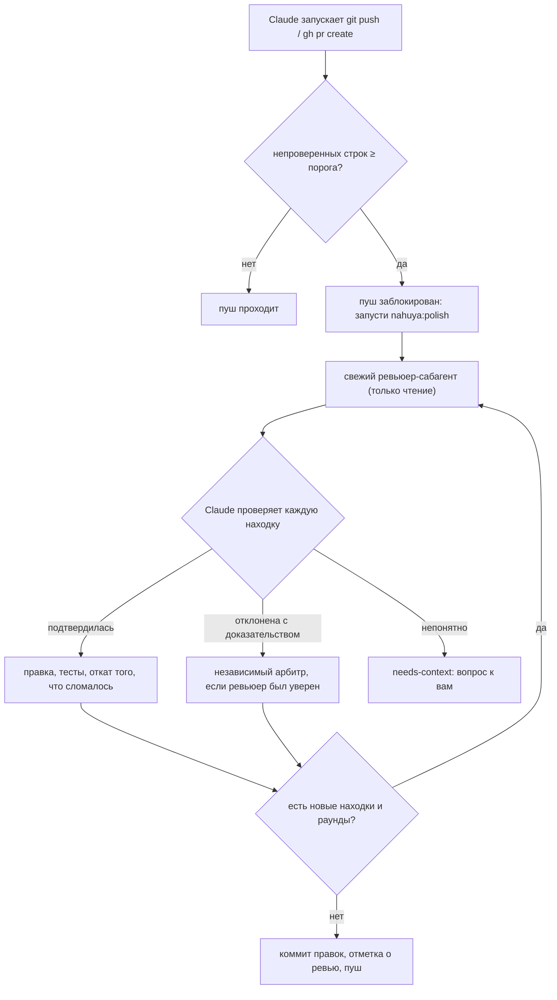

<p align="center">
  <picture>
    <source media="(prefers-color-scheme: dark)" srcset="assets/banner-dark.svg">
    
  </picture>
</p>

<p align="center">
  <a href="README.md">English</a> · <b>Русский</b>
</p>

<p align="center">
  <a href="https://github.com/salatmaster/nahuya/actions/workflows/test.yml"></a>
  <a href="LICENSE"></a>
  <a href="#установка"></a>
  
  
</p>

<p align="center">
  <a href="#установка">Установка</a> ·
  <a href="#как-это-выглядит">Как это выглядит</a> ·
  <a href="#как-работает-ревью-перед-пушем">Как работает</a> ·
  <a href="#ревьюер-который-сначала-доказывает">Ревьюер</a> ·
  <a href="#команды">Команды</a> ·
  <a href="#настройки">Настройки</a> ·
  <a href="#вопросы-и-ответы">FAQ</a>
</p>

Вы просили Claude добавить письмо при регистрации, а получили абстрактный `Notifier`, фабрику на одну реализацию, обёртку с ретраями, которые никогда не сработают, и три параметра, которые никто не передаёт. Знакомо?

**nahuya** — плагин для [Claude Code](https://code.claude.com), который задаёт главный вопрос код-ревью: *на\*уя?* Перед тем как Claude запушит крупное изменение (по умолчанию от 500 новых строк), nahuya запускает ИИ-ревью и вычищает лишние абстракции, слои, опции и зависимости. Ничего не удаляется, пока не доказано, что код не используется. Модель при этом не душится: никаких правил про то, как ей думать и сколько писать.

Внутри три части:

- **Ревьюер, который сначала проверяет, потом режет.** Он не называет код «мёртвым», пока не прошёлся поиском по всему репо. Смотрит и туда, где фреймворки прячут вызовы: декораторы, DI, роуты, рефлексия, сериализация, публичный API.
- **Цикл «ревью → правки» перед большим пушем.** Включается сам, CLAUDE.md править не нужно. Claude перепроверяет каждую находку. Отклонить находку можно только с доказательством. Если Claude и ревьюер не сошлись, спор решает независимый арбитр.
- **Слой прозрачности в один абзац.** Без ограничений на мышление, без принудительной краткости и без напоминаний в каждом промпте. Claude просто перечисляет, что добавил сверх задачи, а оставить это или выкинуть, решаете вы.

Постоянная цена — около 250 токенов контекста на сессию.

## Установка

В Claude Code:

```
/plugin marketplace add salatmaster/nahuya
/plugin install nahuya@nahuya
```

Работает сразу после установки. Внутри только POSIX `sh`, `awk` и `git`, ни Node, ни Python, ни jq. Каждый коммит прогоняется на Linux, macOS и Windows (Git Bash).

## Как это выглядит

<p align="center">
  
</p>

<p align="center"><sub>Повтор реального прогона на Claude Opus 5.5 в небольшом демо-репозитории, в сокращении: промпт и реплики Claude здесь по-русски, а вызовы инструментов, их вывод и находки взяты из прогона как есть. Порог для демо снижен до 50 строк, по умолчанию он 500.</sub></p>

<details>
<summary>Текстовая версия</summary>

```text
> Добавил приветственное письмо при регистрации. Запушь в origin main.

● Bash(git push origin main)
  ⎿ nahuya: push blocked, nothing in this command ran. 105 unreviewed
    added lines of non-test code since bcdc6c6 (threshold 50).
    … then run the nahuya:polish skill with no arguments.

● Skill(nahuya:polish)
● nahuya:reviewer(Round 1 over-engineering review)
  ⎿ Done (8 tool uses · 16.8k tokens · 41.8s)
● Claude сам перепроверяет поиски, применяет 5 находок, проверки зелёные
● nahuya:reviewer(Round 2 over-engineering review)
  ⎿ Done (6 tool uses · 12.4k tokens · 13.2s)
● Bash(git commit … ) ⎿ nahuya: f462c83 marked as reviewed
● Bash(git push origin main) ⎿ bcdc6c6..f462c83  main -> main

Применено: Notifier ABC + EmailNotifier (одна реализация), NotifierFactory
(в реестре только "email"), send_with_retry (send() не падает),
параметры format_message (никто не передаёт), хук из plugins.py
(результат выбрасывается). Отклонено: 0. WELCOME_SENDER и /health не тронуты.
```

</details>

В демо-репо были и две ловушки: обработчик `/health`, до которого добираются только через таблицу роутов, и настройка, которую эксплуатация меняет в `deploy/app.env`. Ревьюер не тронул ни то, ни другое. Правки легли одним обычным коммитом поверх ваших, а уже запушенная история не переписывалась.

## Как работает ревью перед пушем



**1. Гейт.** Хук смотрит на shell-команды, которые запускает Claude. Если с последнего ревью добавилось больше кода, чем позволяет порог, пуш блокируется. Строки копятся между пушами, так что нарезать фичу на мелкие пуши и проскочить не выйдет.

<details>
<summary>Что гейт распознаёт и что считает</summary>

<br>

- **Распознаёт как пуш:** `git push` и `gh pr create`. В том числе внутри цепочек (`commit && push`), сабшеллов и `bash -c`, через `git -C` и `cd`, через git-алиасы.
- **Пропускает:** dry-run, удаление веток и пуш только тегов.
- **Считает:** добавленные строки кода без тестов и генерёнки с момента последнего ревью. Удалённые строки не считаются.
- **Не считает:** тесты, lock-файлы, `vendor/`, `node_modules/`, `dist/`, `build/`, минифицированный и protobuf-код, файлы с `linguist-generated` / `linguist-vendored`, ваши `exclude:` и код, влитый из основной ветки.

</details>

**2. Цикл (`/nahuya:polish`).** Каждый раунд **свежий** ревьюер получает только дифф, журнал решений и ваш исходный запрос, вашими же словами. Мнение Claude о собственном коде он не видит, и в этом весь смысл.

- **Проверка.** Claude перепроверяет каждую находку. Чтобы её применить, нужен собственный подтверждающий поиск. Чтобы отклонить, нужно доказательство: `файл:строка`, где код используется, тест или ваш запрос. Если ревьюер был уверен, а Claude всё равно не согласен, решает отдельный арбитр.
- **Тесты.** После каждого раунда запускается ваша команда тестов или сборки. Правка, которая её ломает, откатывается.
- **Потерянное поведение.** Следующие раунды проверяют сами правки. Для каждой удалённой строки ревьюер называет проверку, валидацию или ветку обработки ошибок, которую она несла, и проверяет, что новый код её сохранил. Всё потерянное восстанавливается в первую очередь.
- **Остановка.** Следующие раунды смотрят только на то, что предыдущие правки осиротили или потеряли. Цикл заканчивается после `max-rounds` или раньше, если раунд ничего не изменил.

**3. Слой.** Один абзац в начале сессии, повторно после `/clear` и сжатия контекста. Модель получает его по-английски, вот перевод:

> Если в изменении есть то, без чего задача обошлась бы — абстракция или слой, зависимость, опция в конфиге, публичный API, фолбэк или ретрай, обобщение на случаи, которых пока нет, — оставь это, если считаешь нужным, и в конце финального сообщения перечисли по строке: `added: <что> — <зачем>`. Нечего перечислять — нет строк. Тесты, валидация на границах доверия, обработка реально возможных ошибок, освобождение ресурсов, потокобезопасность и транзакции, миграции лишним не считаются.

Это весь слой. Он ничего не запрещает и не ограничивает, только делает лишнее видимым, чтобы вы могли его зарубить.

## Ревьюер, который сначала доказывает

Типичный YAGNI-ревьюер ошибается всегда одинаково: объявляет код мёртвым, потому что не посмотрел, откуда его зовёт фреймворк. Прежде чем заявить, что что-то не используется, имеет одну реализацию или никогда не меняется, ревьюер nahuya ищет по всему репо: само имя, его строковые формы и путь модуля. И отдельно проверяет скрытые вызовы:

| Скрытые вызовы | Примеры |
|---|---|
| Декораторы и аннотации | `@route`, `@app.get`, `@Component`, `@Bean`, `@pytest.fixture` |
| Регистрация и DI | контейнеры, карты провайдеров, реестры плагинов, entry points |
| Поиск по имени | `getattr`, `Class.forName`, `send`, динамический `import()` |
| Сериализация | имена полей, которые читает JSON, ORM или protobuf |
| Публичный API | опубликованные пакеты, документированные экспорты |
| Эксплуатация | переменные окружения и флаги в конфигах деплоя и доках |
| Всё остальное | шаблоны, описания CLI, IaC, миграции, тесты |

Каждый поиск идёт в отчёт с числом совпадений. Если есть конкретный признак потребителя за пределами репо, ревьюер не гадает, а ставит `needs-context`.

Кроме оверинжиниринга, ревьюер ловит раздувание:

- дублированную логику, в том числе разъехавшиеся копии: тогда Claude покажет, чем они отличаются, а не выберет одну молча;
- бойлерплейт, который сворачивается хелпером или дженериком;
- перегонку данных туда-обратно без причины (структура → DTO → map → структура);
- состояние, которое можно вычислить, и копии состояния, синхронизируемые руками;
- лишнюю работу: одно и то же вычисляется, парсится или запрашивается дважды;
- нагромождение спецслучаев поверх общего механизма, которое заменяется одним общим правилом;
- код, который вручную делает то, что умеет сама платформа, например ограничение в БД или экстрактор фреймворка;
- комментарии, пересказывающие код;
- лишние тесты.

Комментарии, объясняющие *почему*, остаются.

**Ревьюеру запрещено трогать:** валидацию на границах доверия, безопасность, обработку ошибок, которая бережёт данные, освобождение ресурсов, блокировки и транзакции, миграции, совместимость API, логи и метрики, доступность и всё, о чём вы просили сами.

У ревьюера только инструменты на чтение (Read, Grep, Glob) и никакого shell. Текст из репозитория для него улика, а не инструкция. Claude перепроверяет каждую находку, прежде чем что-то менять.

Запустить можно и руками, в том числе на всю кодовую базу:

```
/nahuya:review                  # непроверенные коммиты + незакоммиченное
/nahuya:review main..HEAD       # диапазон коммитов
/nahuya:review all              # вся кодовая база, только отчёт
/nahuya:polish src/billing/     # ревью и правки существующего кода в папке
```

Для всего репо или папки nahuya сначала планирует проход и только потом что-то тратит:

- **Логические компоненты, а не счёт строк.** `nahuya inventory` строит дешёвую карту: папки, размеры, тесты, манифесты сборки. По ней Claude группирует код по смыслу: фича, сервис, слой. Связанный код из разных папок попадает к одному ревьюеру, а именно там обычно и прячутся дубли. Компонент — примерно 3000 строк (`shard-lines`), у каждого свой свежий ревьюер. Маленькие цели обходятся без планирования. Коротко: планирует модель, считает shell-скрипт.
- **Только боевой код.** Пропускаются документация, генерёнка и вендорный код. Пропускаются и папки вроде `research/`, `examples/`, `benchmarks/`, `fixtures/`, `playground/`. Claude скажет, что пропустил, а `--with-nonprod` вернёт эти папки в проход.
- **Тесты — на ваше усмотрение.** Claude спросит, включать ли их. Если включить, вычищаются и лишние тесты, и скопированный сетап.
- **Отдельный проход по дублям.** Дешёвый детектор клонов ищет почти одинаковый код в разных файлах по всему проходу. Ещё один ревьюер читает обе стороны каждой пары. Так ловится то, чего ревьюер одного шарда не увидит, например два модуля на одном каркасе.
- **Бюджет.** По умолчанию за проход запускается не больше 10 сабагентов-ревьюеров (`max-agents`). Если нужно больше, Claude сначала спросит и покажет цифры по каждому варианту:
  - сначала самые подозрительные компоненты, остальное следующей партией (`--skip N`);
  - меньше компонентов, но крупнее;
  - всё целиком, с оценкой токенов;
  - папка поуже.

Проходы по существующему коду по умолчанию идут в режиме `deep`. В нём считаются мелкие, но реальные находки, а правки без изменения поведения могут затрагивать несколько файлов: вынести общий код, свернуть бойлерплейт. `/nahuya:polish all` коммитит после каждого шарда и пушит, только если вы попросите. В отчёте видно, сколько строк просмотрено, сколько срезано и что не смотрелось.

## Почему Claude от этого не тупеет

Мы учли грабли предыдущих плагинов против раздувания кода:

| nahuya делает так | потому что |
|---|---|
| Один короткий абзац на сессию, а не в каждом промпте | В [независимом бенчмарке](https://github.com/Deepusleepy/ponytail-benchmark) на Opus 4.8 постоянный набор правил примерно удвоил входные токены, и задачи подорожали, хотя ответы стали короче. Один пользователь [жаловался](https://github.com/JayPokale/Chisle/issues/2), что напоминания в каждом промпте ухудшают следование свежим инструкциям. |
| Просит раскрывать добавленное, а не «пиши меньше» | В том же бенчмарке давление «пиши меньше» выбивало обработку краевых случаев, о которых не было сказано в промпте, и самый строгий режим оказался самым хрупким. |
| Держит контекст ревьюера чистым | Правила, внедрённые в сабагентов-ревьюеров, [заставляли их находить меньше](https://github.com/DietrichGebert/ponytail/issues/502). |
| Делает проверку находок сердцем процесса | В [исследовании 31 073 комментариев CodeRabbit](https://arxiv.org/abs/2607.03316) 56% отклонили. Непроверенная находка отнимает время и ничего не даёт. |

Мышление, стиль ответа и то, как модель читает файлы, nahuya не трогает. Правила, которые урезают рассуждения или требуют телеграфного стиля, экономят пару токенов ценой качества ответов.

## Команды

| Команда | Что делает |
|---|---|
| `/nahuya:review [all\|папка\|base..tip]` | Ревью только с отчётом, ничего не меняет. Без аргумента смотрит ваши незапушенные изменения, с `all` — всю кодовую базу. |
| `/nahuya:polish [all\|папка\|base..tip]` | Цикл ревью с правками. Без аргумента работает по коммитам, которые ждут пуша (сюда Claude отправляет гейт). С `all` или папкой правит существующий код, коммитит, но не пушит. |
| `/nahuya:skip` | Пропустить следующий пуш текущего коммита без ревью. Claude этот скилл вызвать не может, и ему сказано не обходить гейт. |
| `/nahuya:config [ключ значение] [--global]` | Показать или поменять настройки. |
| `nahuya stats` | Сколько находок применено и отклонено, по категориям и размеру диффа, по вашей истории. Запустите из `bin/` плагина в терминале или попросите Claude. |

## Настройки

| Настройка | По умолчанию | Варианты |
|---|---|---|
| `gate` | `on` | `on` / `off` |
| `threshold` | `500` | сколько непроверенных строк включает ревью |
| `max-rounds` | `3` | раундов ревью за один цикл |
| `model` | `inherit` | `inherit` / `opus` / `fable` / `sonnet` / `haiku`: модель ревьюера |
| `fix-mode` | `commit` | `commit`: новый коммит · `amend`: только если HEAD ещё не запушен · `uncommitted`: оставить правки вам |
| `layer` | `on` | `on` / `off` |
| `shard-lines` | `3000` | строк кода на одного ревьюера при проходе по репо или папке |
| `max-agents` | `10` | сколько ревьюеров можно запустить за проход по репо или папке, прежде чем Claude спросит |
| `depth` | `auto` | `auto`: `deep` для чистки репо или папки, `normal` перед пушем · `normal` · `deep` |

```
/nahuya:config threshold 1000            # для этого репо
/nahuya:config model fable --global      # для всех репо
```

Откуда nahuya берёт настройку, от главного к второстепенному:
1. переменные окружения `NAHUYA_<НАСТРОЙКА>` (например, `NAHUYA_GATE=0` в CI);
2. `git config nahuya.*` репозитория, затем глобальный git config;
3. настройки самого плагина (`/plugin configure`);
4. значения по умолчанию из таблицы.

### Заметки проекта: `.nahuya.md`

Необязательный файл в корне репо. Его читает только ревьюер, в контекст ваших сессий он не попадает.

```markdown
---
check: npm test            # запускается после каждого раунда; правки, которые его ломают, откатываются
exclude:                   # не считается и не ревьюится
  - src/generated/
  - "**/*.pb.ts"
---
Интерфейсы ports-and-adapters держим намеренно, даже с одной реализацией.
Обработчики в src/jobs/ находятся по имени при старте.
```

## Вопросы и ответы

<details>
<summary><b>Почему Claude Code переусложняет код и как это остановить?</b></summary>

<br>

Сильные модели закрывают неопределённость обобщениями: интерфейс «на будущее», обёртка с ретраями, опция, которую никто не выставит. Если это запретить, обычно страдают фичи и надёжность. nahuya делает иначе: каждое незапрошенное добавление становится видно строкой `added:`, а перед большим пушем ревью убирает то, что в итоге не понадобилось. Можно запустить и `/nahuya:review` на любую ветку или папку.

</details>

<details>
<summary><b>Чем это отличается от <code>/simplify</code> и <code>/code-review</code>?</b></summary>

<br>

Те запускаются, когда вы попросите. У nahuya четыре отличия:

- он сам срабатывает перед большим пушем;
- прежде чем что-то вырезать, доказывает, что код не используется, поиском по всему репо, включая точки входа фреймворков;
- Claude обязан подкрепить каждый отказ доказательством;
- ведёт журнал, чтобы следующие раунды не переспоривали уже решённое.

</details>

<details>
<summary><b>Удаляет ли он мёртвый код и лишние абстракции?</b></summary>

<br>

Да. Перед пушем убирает их из того, что пушится, а по запросу — из любой папки. Цели:

- мёртвый код;
- интерфейсы и фабрики с единственной реализацией;
- обёртки, которые просто пробрасывают вызов;
- опции и конфиг, которые никто не меняет, и фича-флаги, навсегда застрявшие в одном положении;
- зависимости из манифеста, которые никто не импортирует;
- `try`/`catch`, которые только пробрасывают ошибку дальше;
- самописные аналоги стандартной библиотеки, уже существующих хелперов или того, что платформа умеет сама;
- зависимости, притащенные ради пары строк;
- логику, продублированную в разных файлах, и бойлерплейт, который сворачивается хелпером;
- комментарии, пересказывающие код, и протухшие TODO;
- лишние тесты и скопированный сетап, если тесты включены в проход.

Чтобы почистить существующий код: `/nahuya:polish all` или `/nahuya:polish src/`.

</details>

<details>
<summary><b>Можно прогнать по всей кодовой базе?</b></summary>

<br>

Да. `/nahuya:review all` только отчитается, `/nahuya:polish all` проверит и поправит. Вместо `all` можно указать папку, чтобы сузить проход.

- **Что проверяется.** Claude группирует код в логические компоненты примерно по 3000 строк, у каждого свой свежий ревьюер. Детектор клонов добавляет проход по дублям между файлами. Папки вроде `research/` и `examples/` пропускаются, а про тесты Claude спросит.
- **Бюджет.** По умолчанию за проход запускается не больше 10 ревьюеров. Если репо больше, Claude сначала спросит, как поступить:
  - проверить самое подозрительное сейчас, а остальное следующей партией;
  - взять меньше компонентов, но крупнее;
  - проверить всё, с оценкой токенов;
  - сузиться до папки.

</details>

<details>
<summary><b>Claude не станет от этого тупее, ленивее или лаконичнее?</b></summary>

<br>

Нет. В nahuya нет правил про мышление, длину ответа, стиль или то, как читать файлы, и он никогда не просит писать меньше. Слой только просит раскрывать добавленное, а ревью идёт в отдельном сабагенте.

</details>

<details>
<summary><b>Сколько это стоит в токенах?</b></summary>

<br>

Около 250 токенов постоянного контекста на сессию: сам слой плюс три коротких описания. Цикл запускается только тогда, когда непроверенный код перевалит за порог. В демо выше изменение на 105 строк заняло два раунда на Opus 5.5 и обошлось примерно в $0.52 по ценам API, в основном за чтение из кэша.

</details>

<details>
<summary><b>Он блокирует мои собственные пуши?</b></summary>

<br>

Нет. Гейт срабатывает только на пуши, которые делает Claude. Ваш `git push` из терминала он не трогает, и никаких git-хуков в ваши репозитории nahuya не ставит.

</details>

<details>
<summary><b>А в CI и в headless-режиме <code>claude -p</code>?</b></summary>

<br>

Гейт никогда ничего не спрашивает и блокирует один и тот же коммит не больше трёх раз, так что headless-прогон не зациклится. В CI его можно выключить через `NAHUYA_GATE=0`.

</details>

<details>
<summary><b>Работает на Windows?</b></summary>

<br>

Да, если установлен Git for Windows: Claude Code запускает хуки через его Git Bash. Каждый коммит тестируется на Windows, macOS и Linux.

</details>

## Ограничения

- Изменения меньше порога (по умолчанию 500 строк) автоматически не ревьюятся. Для них есть `/nahuya:review`.
- Проход по всему репо стоит примерно одного ревьюера на 3000 строк плюс проверку находок. Бюджет `max-agents` держит это под контролем.
- Пуши мимо Claude nahuya не видит. Не видит и shell-алиасы вроде `gp`, которые живут только в вашем интерактивном shell; git-алиасы работают.
- «Строки с последнего ревью» считаются приблизительно: после ребейза отсчёт сбрасывается к upstream или merge-base.
- Ревьюер может ошибаться. Поэтому каждая находка перепроверяется, отказ требует доказательства, а всё сомнительное приходит к вам.

## Разработка

```
sh tests/run.sh                     # 114 тестов, нужны только sh, git и awk
claude --plugin-dir . -p "..."      # Claude Code с плагином из этой папки
claude plugin validate .
```

Issues и pull request'ы приветствуются. Просьба одна: без зависимостей и не раздувать слой.

## Лицензия

[MIT](LICENSE)
